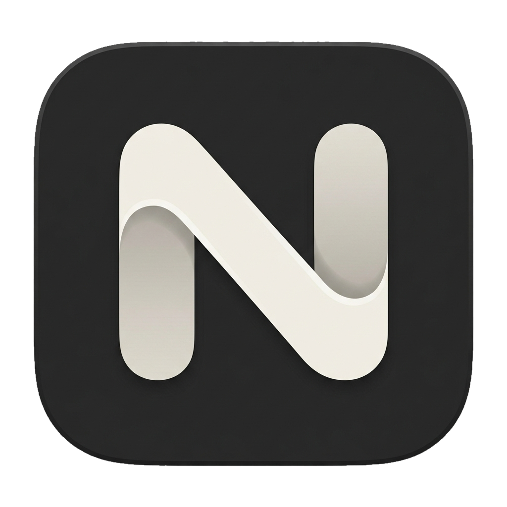

<p align="center">
  
</p>

<h1 align="center">Navo</h1>

<p align="center">
  <strong>An Agent Development Environment built around your tasks.</strong><br />
  Organize tasks, run coding agents, manage workspaces, and review changes in one desktop app.
</p>

<p align="center">
  <a href="README.md">简体中文</a> · <strong>English</strong>
</p>

<p align="center">
  <a href="#getting-started">Getting started</a> · <a href="docs/development.md">Development guide</a> · <a href="https://github.com/leezhian/navo/issues">Feedback</a>
</p>

> [!IMPORTANT]
> **Navo is still in Beta testing and active development.** Features, interactions, and data structures are evolving, and some functionality may be incomplete or unstable. macOS is the current priority. Try it out and share your feedback.

## Features

### Run agents in one workspace

Run the native CLIs for Claude Code, Codex, Grok Build, and Antigravity with their familiar terminal interfaces. Create multiple sessions within a task, choose models, modes, and reasoning levels supported by your installed CLI, and manage session startup, shutdown, archiving, and resumption.

[Explore agent settings →](docs/prd/settings/agents.md)

### Organize development around tasks

Manage pending, completed, and archived tasks in a board or list. Filter by status or project and sort by date, title, or project. Keep descriptions, attachments, links, and multiple repositories or folders together. Move between task details and dedicated tabs while keeping sessions attached to their work.

[Explore task management →](docs/prd/tasks.md)

### Give tasks their own workspaces

Reuse an existing working directory, create a branch, or give a task an isolated Git worktree. Add local repositories and folders, clone over HTTPS or SSH, and run configured worktree initialization commands to keep file changes separate across parallel tasks.

[Explore workspace setup →](docs/prd/task-create.md#4-工作目录选择与配置)

### Keep context and notes with the task

Maintain task descriptions, file references, links, and Markdown notes in one place. Agents connected to the task MCP can read the latest context on demand and create, update, or delete regular notes within that task. Sessions without the required capabilities use file context; availability depends on the CLI.

[Explore task context →](docs/prd/task-workspace.md#32-动态共享上下文)

### Review code inside the workspace

Inspect branches, staged changes, and unstaged changes. Open the full diff view to read changes, add comments on individual lines, and stage, unstage, commit, or push. Reviews and agent sessions stay connected to the same task, making changes easier to inspect and deliver.

[Explore code review →](docs/prd/review.md)

### Arrange the app around your workflow

Combine two task tabs side by side or vertically and drag to adjust their proportions. Run commands in a separate shell within a task, and open context, notes, or changes as needed. Choose light, dark, or system themes, and switch instantly between English and Simplified Chinese.

[Explore workspace layouts →](docs/prd/workspace.md)

### Inspect session traces when needed

Install and enable Session Trace separately in **Settings → Labs** to inspect messages, tool calls, and results from linked native sessions. The extension is neither installed nor enabled by default. It reads the matching local history without modifying it, helping you understand an agent's execution.

[Explore Labs →](docs/prd/settings/labs.md)

## Supported agents

Navo currently includes integration and configuration for these four CLIs:

| Agent | Local command |
| --- | --- |
| Claude Code | `claude` |
| Codex | `codex` |
| Grok Build | `grok` |
| Antigravity | `agy` |

Use **Settings → Agents** to check installation and login status, choose a default agent, or set a custom executable path. Install and sign in to the relevant CLI before using it. Models, modes, reasoning levels, and session resumption depend on the installed CLI's capabilities. The native Codex terminal currently supports only the `default` collaboration mode.

## Current scope

- **Local workflow:** Tasks, settings, and resource records are stored on your machine. No Navo cloud account is required. Model requests are still handled by your chosen CLI and its provider.
- **Issues and pull requests:** Local lists, boards, and task associations are available. Authorization and remote synchronization with GitHub, GitLab, Linear, and other providers are not connected yet.
- **Execution:** The current workflow runs on your own machine. Remote agent execution, cloud team collaboration, and a custom chat interface are not available.
- **Updates:** Online version checks, downloads, and installation for the main app are not connected yet. The Session Trace extension has a separate installation and update mechanism.

See the [backlog](docs/backlog.md) and [product requirements](PRD.md) for detailed scope.

## Getting started

### Requirements

- Node.js **22.13+**.
- **pnpm** and **Git**.
- **macOS** is the current priority for local development and evaluation.
- At least one supported CLI installed and signed in if you want to run an agent.

### Run from source

```bash
git clone https://github.com/leezhian/navo.git
cd navo
pnpm install
pnpm start
```

Use pnpm to apply the lockfile and terminal dependency patches. `pnpm start` opens the actual Electron desktop app.

### Create your first task

1. Open **Settings → Agents** to detect and enable the agent you want to use.
2. Add a local directory or clone a repository in **Settings → Repositories & Folders**.
3. Create a task, add a description, select working directories, and choose a branch or worktree mode as needed.
4. Select an agent configuration and create the task, then use its workspace to run sessions, maintain notes, and review changes.

The first launch shows empty task and issue lists. Demo data is not created automatically.

## Development and builds

Navo is built with **Electron Forge, Vite, React, TypeScript, Tailwind CSS, and shadcn / Radix UI**. The terminal uses **node-pty + ghostty-web**, diffs use **@pierre/diffs**, and tasks and settings are stored in local **SQLite**.

| Command | Purpose |
| --- | --- |
| `pnpm start` | Start the development app |
| `pnpm lint` | Run ESLint |
| `pnpm test:i18n` | Check translations and language switching |
| `pnpm build` | Package a local application directory |
| `pnpm make` | Generate distributable artifacts for the current platform |

Key directories: `src/components` contains the UI, `src/hooks` manages state and effects, `src/services` wraps renderer data access, `src/main-process` provides local services, and `src/shared` defines contracts shared across processes.

See the [development guide](docs/development.md) for environment setup, builds, project structure, storage compatibility, and validation commands.

## Documentation

The detailed project documentation below is currently maintained in Chinese.

| Document | Contents |
| --- | --- |
| [Development guide](docs/development.md) | Local development, packaging, implementation, and validation |
| [Product requirements](PRD.md) | Product goals, scope, and page index |
| [Page requirements](docs/prd/) | Features, interactions, and acceptance criteria |
| [Design guidelines](DESIGN.md) | Visual style, shared components, and motion |
| [Internationalization](docs/i18n.md) | Translation resources, semantic keys, and new languages |
| [Diagnostics](docs/diagnostics.md) | Log access and recording boundaries |
| [Backlog](docs/backlog.md) | Capabilities still to be connected and future scope |
| [Session Trace architecture](docs/session-trace-labs.md) | Technical design for Labs and the trace extension |

## Feedback and contributions

Report bugs and suggest features through [GitHub Issues](https://github.com/leezhian/navo/issues). Include your Navo version, operating system, relevant CLI version, and steps to reproduce the issue.

Before contributing, read the [development guide](docs/development.md) and [project conventions](AGENTS.md). Keep feature descriptions and Beta status in sync when updating the Chinese and English READMEs.

## License

Navo is licensed under the [MIT License](LICENSE). Third-party components are covered by their respective licenses.
