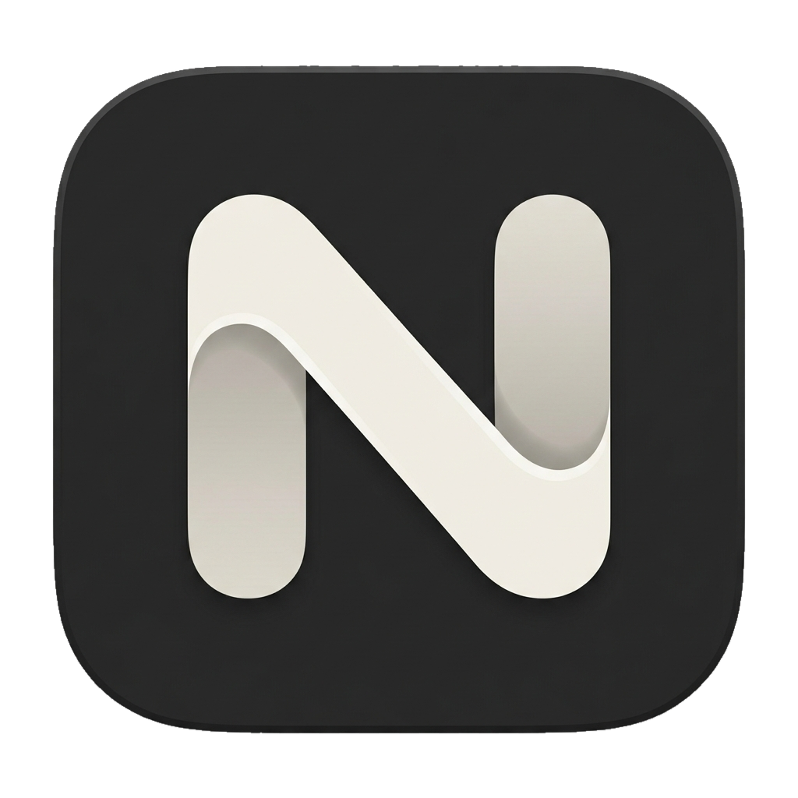

<p align="center">
  
</p>

<h1 align="center">Navo</h1>

<p align="center">
  <strong>以任务为中心的 Agent 开发环境。</strong><br />
  在一个桌面工作台中组织任务、运行编程 Agent、管理工作区并审查代码改动。
</p>

<p align="center">
  <strong>简体中文</strong> · <a href="README.en.md">English</a>
</p>

<p align="center">
  <a href="#快速开始">快速开始</a> · <a href="docs/development.md">开发指南</a> · <a href="https://github.com/leezhian/navo/issues">问题反馈</a>
</p>

> [!IMPORTANT]
> **Navo 仍处于 Beta 测试与开发阶段。** 功能、交互与数据结构仍在持续调整，可能存在不完整功能或稳定性问题。目前优先支持 macOS，欢迎试用并反馈问题。

## 软件特性

### 在同一个工作台中运行 Agent

运行 Claude Code、Codex、Grok Build 和 Antigravity 的原生 CLI，保留熟悉的终端交互。可在一个任务下创建多个会话，按本机 CLI 实际能力选择模型、模式和思考等级，并管理会话的启动、停止、归档及恢复。

[了解 Agent 配置 →](docs/prd/settings/agents.md)

### 用任务组织开发过程

通过看板或列表管理待办、完成和归档任务，按状态、项目筛选，按日期、标题或项目排序。将描述、附件、链接及多个仓库或文件夹归入同一任务，在任务详情与独立标签之间切换，让工作内容与运行会话保持关联。

[了解任务管理 →](docs/prd/tasks.md)

### 为不同任务准备独立工作区

复用现有工作目录、创建新分支，或为任务建立独立的 Git Worktree。支持登记本地仓库和文件夹、通过 HTTPS / SSH 克隆仓库，以及按配置运行 Worktree 初始化命令，为并行任务隔离文件改动。

[了解工作区配置 →](docs/prd/task-create.md#4-工作目录选择与配置)

### 把上下文与笔记留在任务中

集中维护任务正文、文件引用、链接与 Markdown 笔记。接入任务 MCP 的 Agent 可以按需读取最新上下文，并在当前任务内创建、修改和删除普通笔记；不具备相应能力的会话使用文件上下文，具体能力取决于 CLI。

[了解任务上下文 →](docs/prd/task-workspace.md#32-动态共享上下文)

### 在工作台内审查代码

查看分支、已暂存与未暂存变更，进入完整 Diff 阅读代码差异、添加行级评论，并执行暂存、取消暂存、提交与推送等操作。审查与 Agent 会话关联到同一任务，便于检查和交付改动。

[了解代码审查 →](docs/prd/review.md)

### 按工作习惯安排界面

将两个任务标签组合为左右或上下拆分视图，拖动调整比例。在任务内使用独立 Shell 运行命令，按需展开上下文、笔记和变更面板。支持浅色、深色与跟随系统主题，以及即时切换英文和简体中文。

[了解工作台布局 →](docs/prd/workspace.md)

### 按需查看会话轨迹

在「设置 → 实验室」单独安装并启用会话轨迹，查看已绑定原生会话的消息、工具调用和结果。扩展默认未安装、未启用，只读访问对应的本地历史，帮助回看 Agent 的执行过程。

[了解实验室功能 →](docs/prd/settings/labs.md)

## 支持的 Agent

Navo 当前内置以下四种 CLI 的接入与配置：

| Agent | 本机命令 |
| --- | --- |
| Claude Code | `claude` |
| Codex | `codex` |
| Grok Build | `grok` |
| Antigravity | `agy` |

在「设置 → Agents」中检测安装与登录状态、选择默认 Agent，并按需设置可执行文件路径。使用前需要安装并登录相应 CLI；模型、模式、思考等级和会话恢复以本机 CLI 支持的能力为准。Codex 原生终端当前仅支持 `default` 协作模式。

## 当前范围

- **本地工作流**：任务、设置和资源记录保存在本机，无需 Navo 云端账号。Agent 的模型请求仍由所选 CLI 及其服务商处理。
- **Issue / PR**：已有本地列表、看板和任务关联，GitHub、GitLab、Linear 等平台的授权与远程同步尚未接入。
- **运行环境**：当前围绕本机开发，不提供远程 Agent 执行、云端团队协作或自定义 Chat 界面。
- **更新能力**：主应用的在线版本检查、下载与安装尚未接入；会话轨迹扩展有独立的安装与更新机制。

更完整的能力边界见[待完善功能](docs/backlog.md)和[产品需求](PRD.md)。

## 快速开始

### 环境要求

- Node.js **22.13+**。
- **pnpm** 与 **Git**。
- 当前优先使用 **macOS** 进行本地开发和体验。
- 如需运行 Agent，请准备至少一种已安装、已登录的受支持 CLI。

### 从源码启动

```bash
git clone https://github.com/leezhian/navo.git
cd navo
pnpm install
pnpm start
```

使用 pnpm 安装依赖，以应用锁文件和终端依赖补丁。`pnpm start` 会启动真实的 Electron 桌面窗口。

### 开始第一个任务

1. 在「设置 → Agents」中检测并启用要使用的 Agent。
2. 在「设置 → 仓库与文件夹」中添加本地目录或克隆仓库。
3. 创建任务，填写描述、选择工作目录，并按需选择分支或 Worktree 模式。
4. 选择 Agent 配置并创建任务，进入工作台运行会话、维护笔记和检查改动。

首次启动显示空任务列表与空 Issue 列表，不会自动生成演示数据。

## 开发与构建

Navo 使用 **Electron Forge、Vite、React、TypeScript、Tailwind CSS 和 shadcn / Radix UI** 构建。终端基于 **node-pty + ghostty-web**，Diff 使用 **@pierre/diffs**，任务与设置由本地 **SQLite** 保存。

| 命令 | 用途 |
| --- | --- |
| `pnpm start` | 启动开发应用 |
| `pnpm lint` | 运行 ESLint |
| `pnpm test:i18n` | 检查翻译与语言切换回归 |
| `pnpm build` | 打包本地应用目录 |
| `pnpm make` | 生成当前平台的分发产物 |

主要目录：`src/components` 承载界面，`src/hooks` 管理状态与副作用，`src/services` 封装渲染进程数据访问，`src/main-process` 提供本地服务，`src/shared` 定义进程间共享契约。

完整的环境说明、构建流程、目录结构、存储兼容与验证命令见[开发指南](docs/development.md)。

## 项目文档

| 文档 | 内容 |
| --- | --- |
| [开发指南](docs/development.md) | 本地开发、打包、技术实现与验证 |
| [产品需求索引](PRD.md) | 产品定位、范围边界与页面索引 |
| [页面需求](docs/prd/) | 各页面的功能、交互与验收标准 |
| [设计规范](DESIGN.md) | 通用视觉风格、基础组件与动效 |
| [国际化](docs/i18n.md) | 翻译资源、语义 key 与新增语言 |
| [诊断日志](docs/diagnostics.md) | 日志入口与记录边界 |
| [待完善功能](docs/backlog.md) | 尚未接入的能力与后续范围 |
| [会话轨迹架构](docs/session-trace-labs.md) | 实验室与轨迹扩展的技术设计 |

## 反馈与参与

欢迎通过 [GitHub Issues](https://github.com/leezhian/navo/issues) 提交问题与功能建议。报告问题时，请附上 Navo 版本、操作系统、相关 CLI 版本及复现步骤。

参与开发前请阅读[开发指南](docs/development.md)与[项目协作约定](AGENTS.md)。修改中英文 README 时，请保持功能说明和 Beta 状态同步。

## 开源协议

Navo 采用 [MIT 协议](LICENSE)开源。第三方组件遵循各自的许可证。
